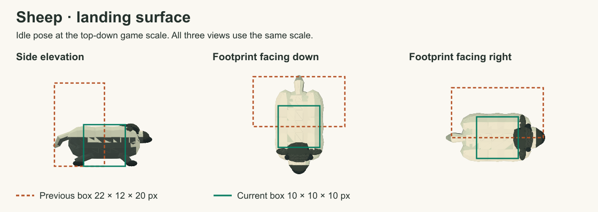

# Fitting wildlife landing surfaces

A ground animal supports the player on one flat-topped, axis-aligned cuboid. Center it under the torso and fit its top near the back in the idle and travel poses. The same collider serves both cameras, all headings, authority and prediction. Mesh sampling is an offline authoring tool.



## Run a batch

Choose about ten exact entity type IDs from [the default models](../src/wildlife/default-models.json). Name the IDs explicitly because classic, provisional and coat variants can have different models or gameplay. Save a baseline outside the checkout before editing.

```sh
node --import tsx scripts/wildlife/contact-fit.mjs --out /tmp/fit-before \
  wildlife-sheep-provisional-v1 wildlife-cow-provisional-v1
# After fitting the same two types
node --import tsx scripts/wildlife/contact-fit.mjs --out /tmp/fit-after \
  --before /tmp/fit-before/report.json --landing \
  wildlife-sheep-provisional-v1 wildlife-cow-provisional-v1
```

Each run writes a JSON report and an SVG per animal. Each SVG shows side elevation and two perpendicular footprints. With a baseline, dashed orange is the old box and solid green is the current one. Open the SVG directly or export a PNG with `rsvg-convert input.svg -o output.png`.

The checker poses the shipped skinned GLB with Three.js at four phases of each available idle and walk clip. It samples downward over the central half of the torso in each horizontal dimension. The median of the uppermost torso intersections gives a back height in world pixels. It measures each camera at the scale used in the game. The footprint check projects a 5 × 5 grid across the box onto the torso and records the lowest coverage across the four headings and two cameras. These samples quantify visual fit. The separate `--landing` check drops real player bodies onto the center and just clear of two edges, verifies ground or animal support, and compares the entity factory, restored actor and replica with the current definition.

## Worker prompt

> Fit the ten listed ground animals in the shared checkout. Capture the baseline first. Inspect the side and plan overlays and idle/travel measurements. Keep one centered, heading-neutral box spanning a useful patch of torso. Choose a stable whole- or half-pixel height close to the upper back across both cameras. Check the largest camera disagreement and the worst footprint coverage. Compare the footprint to the smaller torso width so an artificially tiny box cannot pass on coverage alone. Preserve reachability for mounts and preserve population spacing, interaction ranges, appearance and weight. Check how fresh, restored and replicated animals get the fit. Run the after report with landing checks, plus focused gameplay tests for any affected behaviors. Report old and new dimensions, exceptions and test results. Leave the changes for the supervisor to inspect and commit.

## Supervisor review

1. Supply the exact type IDs, baseline directory and bounded edit scope. For a Yep Anywhere run, verify the creation receipt, effective model, effort and permission mode, then follow the conversation to the worker's result.
2. Regenerate the after report from the checkout. Compare per-animal height error to both camera measurements, coverage across poses and the size of the usable landing area. Check that a footprint improvement in one facing also holds in the perpendicular facing. Inspect overlays for a small animal, a long animal and the numerical outliers.
3. Verify real landings and relevant authored gameplay such as jumping onto a mount and reloading it. Read the diff for effects on sibling variants, save restoration, spawning and steering. If an off-edge landing fails, repeat the drop at the same coordinates and height with the animal removed. A terrain failure needs a flat, seam-free fixture. Return concrete animal failures to the worker or correct them before committing the batch.
4. Record the ten IDs and any exceptions, then start the next worker. Reassess the method when moving to a different anatomy. A rig without recognizable torso weights, a missing travel clip, a swimmer or a hopping animal needs inspection before applying the same measurements.

## Three supervised batches, 2026-11-26

Three fresh Sol 6.2 high sessions ran sequentially through Yep Anywhere v0 with bypass enabled. Each worker fit ten ground animals. The supervisor reran the native geometry and landing checks and inspected the overlay outliers before accepting each batch.

For each animal, height error is the largest absolute difference between the box top and the measured central back across both camera scales and eight sampled idle/walk poses. The table gives the median of those ten errors in world pixels.

| Batch | Species | Median error before | Median error after |
| --- | --- | ---: | ---: |
| 1 | Sheep, pasture cow, goat, piglet, elephant, giraffe, donkey, camel, horse, base cat | 8.55 | 2.20 |
| 2 | Mule, llama, alpaca, zebra, impala, gazelle, springbok, saiga antelope, okapi, warthog | 16.05 | 1.00 |
| 3 | American bison, musk ox, water buffalo, wildebeest, rhinoceros, elk, moose, capybara, red panda, wombat | 15.95 | 0.80 |

All 30 centered drops settled within 0.02 px of the authored height. Players dropped just clear of either tested edge reached the ground. Every footprint’s 25 interior sample points projected onto the torso in all sampled poses, headings and cameras. Footprint sides span 82–99% of the smaller measured torso width; the base cat has the smallest absolute platform at 4 px. The elephant has the largest residual height difference at 4.3 px because its two cameras draw the back at different heights. The horse kept its existing 18 px saddle.

Batch 1 established that a fitted height must also reach saved riders and the Workshop’s **Hop onto** control. Normal jumps reached the sheep from two directions in the game scenario with the sheep held stationary. Batch 2 exposed an off-edge checker failure that reproduced on bare terrain. Moving the targets to tile centers let the reviewer retain rounded fits and verify sustained support. Batch 3 used that revised prompt and fixture on both heavy herds and smaller mammals. Future batches can reuse this workflow for modeled ground quadrupeds. Human play feedback remains the check on feel.
